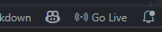
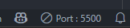

For testing and development purposes, it can be useful to run online experiments locally on your computer. This means that the task will be viewable in a web browser, but it will be running on your computer rather than on a server.

## Running online experiments locally through VSCode

The most straightforward way to do this is via [VSCode](https://code.visualstudio.com/), since this is typically what we use for coding and developing tasks.

First, you will need to open the folder containing your task in VSCode. You can do this by going to `File > Open Folder` and selecting the folder containing your task. Or, alternatively, you can open the terminal and navigate to the folder containing your task using the `cd` command, and then run `code .` to open that folder in VSCode.

To run an online experiment locally in VSCode, you can use the [Live Server extension](https://marketplace.visualstudio.com/items?itemName=ritwickdey.LiveServer). Once installed, this will provide a "Go Live" button in the bottom right corner of VSCode that you can click to start a local server. You can then open your task's `index.html` file and click the "Go Live" button to view the task in your browser. Typically, this will be at `http://localhost:5500/index.html` or something similar (the port, for example `5550` will be shown where the "Go Live" button is).

